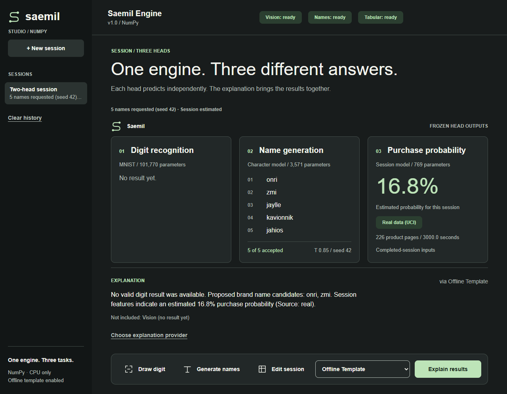
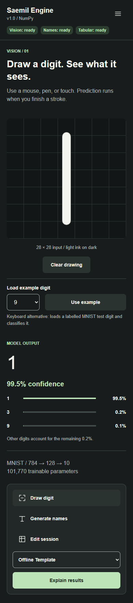

# Saemil AI

Samuel Vroom

[](https://github.com/ninjaVroom/saemil-ai/actions/workflows/tests.yml)

**A neural-network engine written from scratch in NumPy, used to train three unrelated models: an image classifier, a character-level name generator and a tabular probability model.** No PyTorch, TensorFlow or scikit-learn does any learning.



The question behind it: is the engine actually general? If the same `forward` / `backward` / optimizer code can train a vision model, a generative sequence model and a calibrated tabular model, then it is. Each model ("head") adds only its input transform, a network definition and a loss.

## Case study

Saemil uses one small neural-network engine to train on images, names and tabular data. The engine uses NumPy for the array operations. Layers, activation functions, losses and optimizers have explicit forward and backward passes. Each model adds its own input transform and network definition.

The digit model reads a 28-by-28 image. The name model predicts the next character from a three-character context. The tabular model estimates purchase probability from six completed-session totals. They share the same training machinery, while keeping their preprocessing and evaluation separate. Each is compared with a simple baseline on a held-out split.

The browser gives each model a different input: a drawing canvas, name-generation controls or shopping-session fields. FastAPI loads the trained archives and returns the predictions. A separate bridge describes those results. Its default is an offline template; local command-line tools and cloud providers are optional and must be selected explicitly. The explanation provider does not make the prediction.

The checks cover numerical gradients, repeated embedding indices, model loading, provider failures and the browser's digit-centering code. Model archives contain arrays and a JSON manifest, with pickle disabled. The loader checks shapes, types and layer connections before building a network.

This is a local demonstration. It has no authentication and is intended for loopback access. The tabular features describe finished sessions, and generated-name novelty is checked only against the source corpus. Dataset sources, recorded measurements and reproduction commands are included below and in the linked documentation.

## Prototype

Figma prototype link pending.

## Results

Every head is measured on a held-out test split and compared with a simple baseline. Training runs on a laptop CPU in seconds.

| Head | Network | Params | Test result vs baseline | Train time |
|---|---|---|---|---|
| **Vision**: hand-drawn digit (MNIST) | 784 → 128 → 10, ReLU | 101,770 | **93.3%** accuracy (93.75% on the full 10k MNIST test set) | 1.95 s |
| **Names**: new pronounceable names | Embedding(27,8) → 24 → 64 → 27, Tanh | 3,571 | cross-entropy **2.346** vs unigram baseline 2.830 | 1.17 s |
| **Tabular**: will this shopping session buy? (UCI) | 6 → 32 → 16 → 1, ReLU | 769 | log loss **0.4025** vs base rate 0.4306; Brier 0.1242 vs 0.1307 | 0.79 s |

Peak memory stayed under 60 MB for every head. Retraining with the default seeds reproduces the model files byte for byte. Method, hashes and full commands: [docs/REPRODUCE.md](docs/REPRODUCE.md).

## What's worth looking at

- **Backprop by hand.** [`saemil/layers.py`](saemil/layers.py) has the full engine: `Linear`, `Embedding` and `Flatten`, each with an explicit forward and backward pass. The embedding backward pass uses `np.add.at`, so a token that appears twice in one window gets both gradient updates. A plain `dE[ids] += g` silently drops one ([layers.py:73](saemil/layers.py:73)).
- **Gradients checked numerically.** [`tests/test_gradients.py`](tests/test_gradients.py) compares every layer, activation and loss against float64 central differences. Adam is checked against a reference implementation.
- **Model files you can safely load.** `Sequential.save` / `load` ([network.py:86](saemil/network.py:86)) use `.npz` with a JSON manifest and no pickle. On load, every shape, dtype and layer connection is checked before anything is built. Saves go to a temp file that is validated and then atomically swapped in.
- **Calibrated probabilities, not just a score.** The tabular head reports log loss, Brier score and average precision against a constant-prevalence baseline ([heads/tabular.py](heads/tabular.py)).
- **The browser and server preprocess digits identically.** The drawing canvas centres digits in JavaScript ([centering.js](studio/static/centering.js)). A test runs it under Node and checks it against the Python version on 66 shared fixtures.

## Saemil Studio

A local FastAPI app with a vanilla-JS page: draw a digit, generate names, edit a shopping session, then get a short plain-English explanation of all three results. The explanation comes from an offline template by default, or optionally from a local LLM CLI or a cloud API. It never makes predictions. It's built for loopback only, with a Host allowlist, a body-size cap and pickle-free model loading. Details: [docs/PROVIDERS_AND_SECURITY.md](docs/PROVIDERS_AND_SECURITY.md).



More screenshots (desktop, tablet, mobile) are in [`docs/screenshots/`](docs/screenshots/).

## Quick start

Python 3.10+. The trained models are in `models/`, so nothing needs to be downloaded or trained.

```bash
python -m venv .venv
source .venv/bin/activate        # Windows: .venv\Scripts\Activate.ps1
pip install -e ".[studio,dev]"
python -m uvicorn studio.app:app --host 127.0.0.1 --port 8000
```

Open http://127.0.0.1:8000. The engine itself depends only on NumPy; `studio` adds FastAPI and uvicorn, and `dev` adds pytest, pytest-cov, httpx, ruff and mypy. If a model archive is missing or broken, only that head is turned off: its routes return 503 and `/api/status` names the file.

## Tests

```bash
python -m pytest -q --cov --cov-report=term
ruff check .
mypy
```

333 tests, 97% line coverage: gradient checks, XOR, engine save/load, each head, the AI bridge (with network access patched off and vendor adapters tested against fixtures), the studio routes including a live uvicorn server, and the JS/Python centering check (needs `node` on `PATH`). Warnings are treated as errors. CI runs the suite on Python 3.10 to 3.13 and runs ruff and mypy (`check_untyped_defs`) on every push.

`python scripts/ui_walkthrough.py` runs a 58-check headless browser walkthrough and regenerates the screenshots. It needs Playwright for Python and Microsoft Edge, and it currently assumes a Windows `.venv` layout.

## Project layout

```
saemil/           engine: layers, activations, losses, optimizers, Sequential + save/load
heads/            vision.py, names.py, tabular.py: input transforms and network builders
scripts/          prepare_data, distill_data, train, benchmark, ui_walkthrough
saemil_bridge.py  explanation bridge (stdlib only)
studio/           FastAPI app + static UI
models/           trained archives (.npz)
data/             SOURCES.md, prepared splits, synthetic CSV (raw downloads not committed)
tests/            pytest suite and fixtures
docs/             reproduction, providers/security and screenshots
```

## Known limitations

- **The synthetic tabular fallback does not beat its baseline** (log loss 0.4562 vs 0.4541). Its generator is weak by design: the best possible gain is about 0.0065 nats. The studio uses the real UCI model.
- **The tabular model describes completed sessions, not live ones.** Its six features are whole-session totals.
- **Generated names are checked only for novelty against the training corpus.** That is not trademark clearance.
- **Digit centering can differ by one pixel on exact half-pixel ties** between the browser and the server. The server re-centres every input, so predictions always use the server's version.
- **Not tested:** real CLI tools and vendor APIs, screen readers, Firefox and Safari, a real pen. Benchmarks come from one machine (Ryzen 5 5500U).

## Data and licences

Full provenance, hashes and splits: [`data/SOURCES.md`](data/SOURCES.md).

- **MNIST**: Yann LeCun and Corinna Cortes, CC BY-SA 3.0. Whether share-alike applies to `models/vision.npz` has not been assessed.
- **makemore `names.txt`**: karpathy/makemore at commit `988aa59`, MIT License, © 2022 Andrej Karpathy (derived from US SSA baby-name data).
- **UCI Online Shoppers Purchasing Intention**: Sakar, C. & Kastro, Y. (2018), https://doi.org/10.24432/C5F88Q, CC BY 4.0.
- **Synthetic sessions**: generated locally by `scripts/distill_data.py`.
